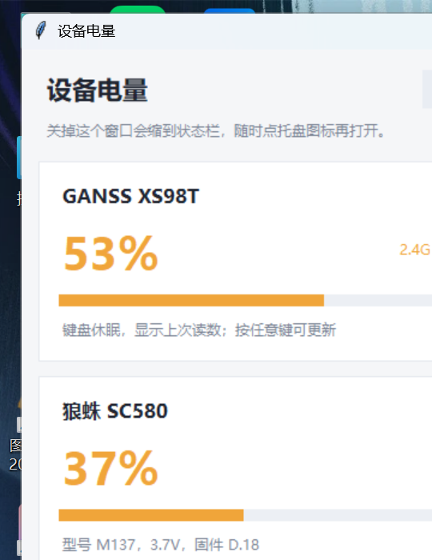
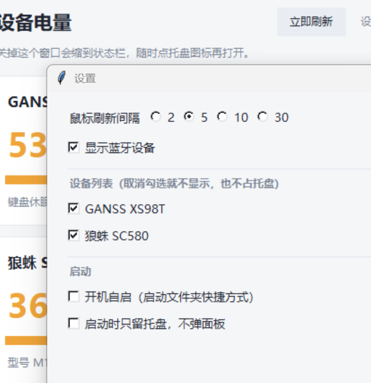

# 设备电量（Windows 托盘电量查看器）

在外面挂一排**圆环托盘图标**，实时显示无线键盘 / 鼠标 / 蓝牙设备的电量。

纯 ctypes 读 HID 与蓝牙属性，**零第三方依赖**，打包后是一个 10 MB 的独立 exe。
这个仓库里的协议是拿真实设备抓包适配出来的，不是通用猜测。




## 特性

- **每台设备一个托盘图标**：粗圆环 + 中间设备图形，颜色随电量变化（≥60 绿 / 30–59 黄 / <30 红）；
- **面板**：大号百分比 + 进度条 + 传输方式 + 数据来源，键盘休眠时显示缓存值并标注；
- **设置**：鼠标刷新间隔、蓝牙开关、**设备列表（勾选控制显隐）**、开机自启、启动只留托盘；
- **高 DPI**：Per-Monitor V2 感知，150% 缩放下字体原生渲染，不发糊；
- **右键托盘**：打开面板 / 立即刷新 / 退出。

## 下载

到 [Releases](../../releases) 下载 `device-battery-*-win64.zip`，解压后运行 `设备电量.exe`。

> ⚠️ 别直接在 zip 里双击运行。请先解压到普通目录（或运行包里的 `安装到本地.bat`），
> 否则文件可能带着低完整性标签，Windows 会让它以低权限启动，**托盘图标会加不上**（`Shell_NotifyIcon` 错误码 5）。

## 支持情况

| 设备 | 识别方式 | 状态 |
|---|---|---|
| **GANSS / 高斯 XS98T 键盘** | 2.4G 接收器 `05AC:024F`，usage page `0xFF60`，33 字节报文 | ✅ 已实测（读数与键盘小屏完全一致） |
| **小米 / 红米耳机、手机、手柄等蓝牙设备** | Windows 蓝牙电量属性 `DEVPKEY_Bluetooth_Battery` | ✅ 已实测（ExpressLRS 手柄 100%） |
| **狼蛛 SC580 鼠标** | 2.4G 接收器 `248A:5B2F`，32 字节 Feature 邮箱（rid `0x0C`） | ✅ 已实测（读数与官方驱动一致，38%） |

> 手机（Redmi K60 等）如果**用蓝牙连到电脑**，系统会给出电量，本工具直接显示；
> 走「小米互联」的互联画面不经过标准接口，这里读不到，也没做屏幕抓取。

## 从源码运行

```bat
python main.py                :: 打开面板（1 秒刷新，后台常驻监听）
python main.py --once         :: 命令行打印一次，等 16 秒抓键盘心跳
python main.py --once --wait 30
python main.py --json         :: 给别的程序吃
python main.py --list         :: 列出所有 HID 接口（排障）
```

双击 `run.bat` 也可以（用 `pythonw` 启动，不弹黑框）。

面板里每台设备一张卡片：大号百分比、进度条（≥60 绿 / 30–59 黄 / <30 红）、
传输方式、数据来源。键盘在省电时不会推送电量，按下任意键就会自动刷新。

## 状态栏图标（托盘）

`python main.py` 会给**每台设备各挂一个通知区域图标**：

* 粗圆环：**48×48 画布**、外径顶满（0.498）、环宽约 0.16、圆头端点；进度 = 电量，颜色随电量变（≥60 绿 / 30–59 黄 / <30 红）；
* 圆环中间是**简化的设备图标**：键盘=圆角框+空格线、鼠标=圆角框+顶部按键缝、耳机=半环+耳罩、手机=竖框+底线；用 SDF 几何图形画（不是字体字形），并按各自形状做了**视觉面积归一**（窄高的鼠标会单独放大，不会显得比键盘小）；线宽也换算成统一的图标坐标，四个图标看起来一样重。
* 不画底色块，字形颜色跟着系统深/浅色主题走（浅色深字、深色白字）；
* 悬停 → `狼蛛 SC580 37%`；右键 → 设备清单 + 打开面板 / 立即刷新 / 退出；
* 左键 → 打开/前置面板；面板点 × 只是收进托盘，进程继续跑。

**不会出现两份**：程序带单实例检查，重复启动只会把已有面板叫到前台。
如果任务栏上还留着一个旧的「37」方块图标，那是上一版进程被强杀留下的僵尸图标，
鼠标划过去（或重启资源管理器）就会消失。

```bat
python main.py            :: 面板 + 托盘
python main.py --hidden   :: 只留托盘图标，不弹面板
```

> Windows 11 默认把**新图标塞进 `^` 溢出区**。第一次用的时候点开 `^`，
> 把两个图标拖到任务栏上就固定住了（或到「设置 → 个性化 → 任务栏 → 其他系统托盘图标」里打开）。

## XS98T 的协议（实测，已写进 `protocols.py`）

接收器 `05AC:024F` 上有两个厂商接口，usage page 都是 `0xFF60` / usage `0x61`：

* `mi_03`：32 字节输入 + 32 字节输出 —— 键盘主动推送状态
* `mi_04`：64 字节输入 + 64 字节输出 —— 写什么都会回一帧 `00 0F 01 xx cc`，与电量无关

键盘唤醒时会**每隔 15 秒**推一帧状态，格式：

```
00 20 01 00 39 00 00 ... 00 5A
│  │  │  │  │              └── 校验：前面所有字节之和的低 8 位（0x20+0x01+0x00+0x39 = 0x5A）
│  │  │  │  └──────────────── 电量百分比 0x39 = 57
│  │  │  └─────────────────── 固定 00
│  │  └────────────────────── 固定 01
│  └───────────────────────── 0x20 = 电量帧
└──────────────────────────── Report ID
```

另一帧 `00 0C 10 00 … 1C` 是链路/握手帧（同样带校验和），与电量无关。

实测对照：键盘小屏 **57%** 时收到 `… 39 …`，**56%** 时收到 `… 38 …`，一一对应。

**为什么必须敲一下键盘？** 2.4G 键盘空闲几十秒后会进省电模式，完全停止上报。
试过向 64 字节通道写各种命令（0x00–0x3F、0xAA 等）想主动查询，键盘都不理，
只有真实按键才会唤醒它。所以工具的做法是：后台一直挂着监听，收到就更新；
没收到时显示上一次的值 + 「键盘休眠」。

## 蓝牙部分

Windows 会把蓝牙配件的电量写在设备属性
`{104EA319-6EE2-4701-BD47-8DDBF425BBE5}` 的第 2 号属性里（`bt_battery.py` 用 SetupAPI 读）。
只要是「设置 → 蓝牙和设备」里能看到电量的设备，这里都能读到：
耳机、手机、手柄、触控笔都行。**前提是先和电脑蓝牙配对并连接。**

## 蓝牙：只显示「已连接」的设备

配对过但已经关掉的设备，PnP 里照样在、电量还是上次的缓存值，所以不能只看「设备存在」。
现在会对每个蓝牙设备问一次 `BluetoothLEDevice.ConnectionStatus`（Windows 只在 WinRT 里
暴露这个值，Python 拿不到，只能借一次 PowerShell，结果缓存 20 秒）：

* 未连接 → 直接从列表里去掉，等它连上再出现；
* PowerShell 不可用 → 按「已连接」处理，宁可多显示也不漏。

## 狼蛛 SC580 的协议（实测，已写进 `protocols.py`）

接收器 `248A:5B2F` 的 `mi_01&col04`（usage page `FF00`）是一路 32 字节 Feature Report，
Report ID `0x0C`，本质是个**邮箱**。查询要**两步**（少一步就只能捡到上次的缓存）：

```
1) 写 0C 01 20 00 0F 01 10 00     ← 让接收器去问鼠标要状态
2) 写 0C 01 20 00 10 01 10 00     ← 把结果取出来
3) 读回 0x0C
```

读回的内容：

```
0C 01 20 00 | 10 01 10 00 | 4D 31 33 37 | 28 01 | 00 25 | 46 FF | 25 00 | ...
 请求回显                    "M137" 型号          3.7V           37%
```

* 下标 **18**（第 19 字节）= 电量百分比，`0x25` = 37%，和官方驱动显示的一致
* 下标 15 = 电压，`0x25` = 37 → 3.7 V
* 下标 8–11 = 型号 `"M137"`，24–27 = 固件 `"D.18"`

**踩过的坑**：一开始只写 `0F 01 10 00` 那一条，结果只有鼠标刚连上时能读到一次，
之后永远返回空——其实是漏了第 2 步的 `10`。补上之后连查 12 次 12 次成功，
面板每 5 秒刷新一次，数值跟着真实电量走（38% → 37%）。

走过但没用的路（留档）：64 字节 `FFEF` 通道只会**原样回显**；33 字节输入通道鼠标怎么动
都不发帧；控制管道 `HidD_GetInputReport` 一律 `ERROR_GEN_FAILURE`；轮询状态下发通道
（没有请求时）永远返回全零。

## 目录说明

| 文件 | 说明 |
|---|---|
| `hid_win.py` | HID 底层：枚举接口、Feature/Input/Output 报文、带超时的异步读 |
| `protocols.py` | 设备协议：XS98T 帧解析、SC580 识别、蓝牙汇总 |
| `monitor.py` | 后台常驻监听（键盘推送不定时，所以缓存最后一次读数） |
| `bt_battery.py` | 蓝牙电量（SetupAPI + PnP 属性） |
| `viewer.py` | tkinter 面板 |
| `main.py` | 命令行入口 |
| `tray.py` | 通知区域图标：每台设备一个，圆环 + 设备图标 + 右键菜单（纯 ctypes） |
| `iconfx.py` | 圆环图标渲染：逐像素超采样 + GDI 字形取 alpha |
| `bt_conn.py` | 蓝牙「是否真的连着」（借 PowerShell 问 WinRT，带缓存） |
| `battery-cache.json` | 上次读到的电量（百分比 + 时间戳），重启面板时先显示它 |
| `probe.py` | 排障：枚举、抓帧、Feature 转储、Raw Input |
| `caps.py` | 打印每个接口的 Report ID / usage / 位宽 |

## 排障

```bat
python probe.py list                  :: 所有 HID 接口
python probe.py caps 05ac:024f        :: 这个设备的 report id / usage 定义
python probe.py watch 05ac 20         :: 抓 20 秒报文（十六进制）
python probe.py feature 248a:5b2f     :: 逐个 Report ID 读 Feature
python probe.py bt                    :: 蓝牙设备及电量
```

## 给别的设备加一份协议

1. `python probe.py list` 找到设备的 `VID:PID` 和带数据的接口（看 `in=` 长度和 usage page）；
2. `python probe.py watch <vid:pid> 30`，一边操作设备一边抓帧；找到数值随电量变化的字节；
3. 在 `protocols.py` 里照 `read_xs98t()` 写一个 `read_xxx()`，在 `collect()` 里加一行。

帧里有校验和就先算校验（常见是累加和 / CRC16），很多设备收到校验错的包会直接丢弃。

另外留意「邮箱」型接口：某个 Feature Report 看上去写什么就读回什么，但其实**写一小段
请求头、等几百毫秒、再读回同一个 Report**，设备会把答案填在里面 —— SC580 就是这么破了。

## 刷新机制 & 缓存

| 设备 | 什么时候会有新读数 |
|---|---|
| XS98T 键盘 | 按键唤醒后，每 15 秒推一帧；后台常驻监听，收到就更新 |
| SC580 鼠标 | **每 5 秒主动查询一次**（0x0F 请求 → 0x10 取回），实时刷新 |
| 蓝牙设备 | Windows 自己维护，每 30 秒重读一次 |

只有键盘需要「按一下」；鼠标是真正可轮询的。

面板会把最后一次读数写进 `battery-cache.json`，标注「缓存值 + 多久之前」；
设备断开时仍能看到上次的值，而不是一片空白。

## 设置

面板右上角「设置」：

| 项 | 说明 |
|---|---|
| 鼠标刷新间隔 | 2 / 5 / 10 / 30 秒，改完立即生效（不用重启） |
| 显示蓝牙设备 | 关掉后只留 2.4G 设备，蓝牙列表为空时不占地方 |
| 开机自启 | 在「启动」文件夹里创建快捷方式（任务管理器→启动 里可见），不是写注册表 |
| 启动时只留托盘 | 开机时不弹面板，只驻留托盘 |

设置存在 exe 同目录的 `settings.json`，删掉就恢复默认。

## 托盘没出现怎么办

> **最常见的一种**：如果你是直接从 `dist\` 目录双击 exe 的 —— 这些文件是在低权限沙箱里打包的，
> 带有一个 **Low 完整性标签**。Windows 会让带这个标签的 exe **同样以低权限启动**，
> 于是它够不着中等权限的任务栏，`Shell_NotifyIcon` 就返回 **错误码 5**。
>
> **解决（二选一）**：
> 1. 把 exe **复制**到别的目录（比如桌面）再运行 —— 复制出来的新文件继承目标目录的普通完整性；
> 2. 用资源管理器解压 `设备电量-免解压版.zip` 再运行；
> 3. 或者右键「以管理员身份运行」（高权限能向下通信，所以也正常）。
>
> 想验证：`icacls 设备电量.exe` 看有没有 `Mandatory Label\Low Mandatory Level`。

程序在启动时会**立刻**加图标（不等第一个定时器），失败的话每秒重试。如果还是没有：

1. 看面板**底部那行字**：会显示「托盘未生效：Shell_NotifyIcon 失败，错误码 X（任务栏可通信=… 管理员=…）」；
2. 看 exe 同目录的 `tray.log`，里面记录了窗口句柄、图标句柄、elevated 和诊断结果；
3. `任务栏可通信=False` 说明权限隔离（见上面那条），面板右下会出现「以管理员重启」按钮；
4. 其它常见原因：资源管理器没起来/被重启、组策略禁用了通知区域、或者被塞进 `^` 溢出区（点开拖出来即可）。

顺带说明：程序已做 **Per-Monitor V2 DPI 感知**，并按实际 DPI 缩放窗口和所有间距 ——
150% 缩放下字体是原生渲染的，不会被系统拉伸导致发糊。（调试时可用环境变量 `DSH_UI_SCALE=1.5` 强制缩放。）

## 设备列表

设置里有「设备列表」，列出自上次启动以来见过的所有设备（键盘 / 鼠标 / 蓝牙耳机…），
**取消勾选 = 这个设备不显示**：面板里没有这张卡片，托盘里也不会给它加图标。

- 勾选状态存进 `settings.json` 的 `disabled_devices`（按设备 key，如 `xs98t` / `sc580` / `bt:<实例ID>`）；
- 鼠标被关掉后连轮询也停了，不再每隔几秒戳一次接收器；
- 暂时没插上的设备不会从列表里消失（记住上次见过的），重新插上直接恢复显示。
## 打包成 exe

`dist\` 里有三个产物，随便挑一个用（都不用装 Python）：

| 文件 | 说明 |
|---|---|
| `dist\设备电量\设备电量.exe` | **推荐**。文件夹版，直接跑，不解压、启动最快 |
| `dist\设备电量-免解压版.zip` | 上面那个文件夹的压缩包，解压后双击里面的 exe |
| `dist\设备电量-单文件.exe` | 单文件（10 MB），启动时就地解压到当前目录 |

> 为什么默认推荐文件夹版？最初的单文件版用的是 PyInstaller 默认行为——先把 40 多 MB
> 的运行时解压到 `%TEMP%`。某些机器上 `%TEMP%` 不可写（权限/杀软/组策略），就会弹出
> **“Could not create temporary directory!”**。文件夹版完全不解压，单文件版也改成
> `--runtime-tmpdir .`（解压到 exe 所在目录），都绕开了这个坑。

自己重新打包：双击 **`build_exe.bat`**（会 `pip install pyinstaller`，需要能访问 PyPI），
会依次生成上面三个文件。手动也行：

```bat
python -m pip install pyinstaller
python make_ico.py
python -m PyInstaller --onedir --noconsole --name "设备电量" --icon app.ico main.py
python -m PyInstaller --onefile --noconsole --name "设备电量-单文件" --icon app.ico --runtime-tmpdir "." main.py
```

其它注意：杀软可能对 PyInstaller 产物误报，加白名单即可；`battery-cache.json` 生成在
exe 同目录，删掉不影响功能。

## 隐私

不联网、不写日志；唯一的落盘是 `battery-cache.json`（只有电量和时间戳，没有设备名/序列号），
删掉它不影响功能。所有读取都在本地 HID / PnP 层完成。

## 目录说明

| 文件 | 作用 |
|---|---|
| `main.py` | 入口（CLI 参数、单实例、DPI 感知） |
| `viewer.py` | 面板（Tk）+ 设置对话框 |
| `tray.py` | 通知区域图标与右键菜单 |
| `iconfx.py` | 用 SDF 数学在内存里画圆环图标 |
| `monitor.py` | 三个后台线程（键盘监听 / 鼠标轮询 / 蓝牙枚举） |
| `protocols.py` | 协议解析、缓存、`Reading` 数据结构 |
| `hid_win.py` | ctypes 封装的 HID 层（SetupAPI + HidP） |
| `bt_battery.py` | 蓝牙设备电量属性读取 |
| `bt_conn.py` | 用 WinRT 查蓝牙连接状态（决定显不显示） |
| `settings.py` | `settings.json` 读写 + 开机自启 |
| `build_exe.bat` | 一键打包 |

## 致谢

协议逆向的起点是 [yszyszysz233/2.4G-battery-viewer](https://github.com/yszyszysz233/2.4G-battery-viewer)，
本仓库在它的基础上重写了协议层与界面，补上了狼蛛 SC580、蓝牙连接状态过滤、托盘圆环图标、
高 DPI 与设置面板。

## 许可

MIT，见 [LICENSE](LICENSE)。
